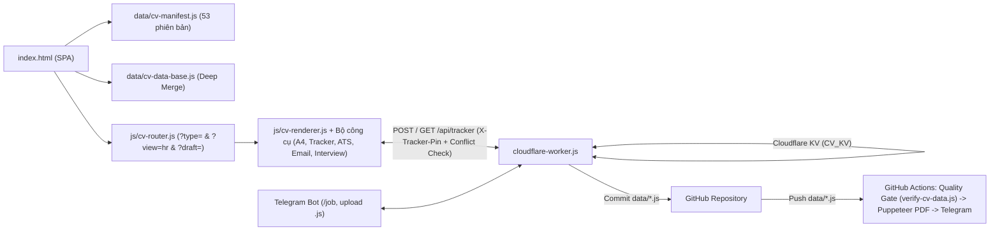

# CV Editor & AI Job Automation Platform

Ứng dụng web tĩnh (Vanilla HTML5/CSS3/ES6+) kết hợp **Serverless Cloudflare Worker**, **LLM API** và **GitHub Actions CI/CD** giúp quản lý, may đo hàng chục phiên bản CV theo từng JD, xem trước chuẩn A4/HR View, theo dõi tiến độ ứng tuyển và tự động xuất PDF gửi về Telegram.

---

## Kiến trúc hệ thống



---

## Tính năng chính

- **Quản lý đa phiên bản CV (`Single Source of Truth`):**
  - Hợp nhất dữ liệu dùng chung tại [data/cv-data-base.js](data/cv-data-base.js) (`mergeWithBaseCv`) và đăng ký tập trung **53 phiên bản CV** trong [data/cv-manifest.js](data/cv-manifest.js).
  - Chuyển nhanh giữa các bản CV qua `?type=<key>`, xem bản nháp qua `?draft=<key>`, hoặc bật chế độ xem tĩnh cho Nhà tuyển dụng qua `?view=hr`.
- **Chuẩn hóa bố cục A4 & Trải nghiệm Mobile:**
  - Thước đo dung lượng trang A4 (`cv-a4-metrics.js`), nút **Magic Fit**, A4 Preview, xuất PDF chuẩn 1 trang qua `@media print` (Whitelist rendering).
  - Trên mobile (`<= 992px`), giữ nguyên tỷ lệ khổ A4 thực tế bằng cơ chế `transform: scale()` tự động căn giữa (chuẩn TopCV) kèm thanh điều hướng Bottom Bar / Top Bar.
- **Job Application Tracker (`js/cv-tracker.js`):**
  - Tự động đọc và đồng bộ danh sách việc làm đã chấm điểm từ [jobs_for_tomorrow.md](jobs_for_tomorrow.md).
  - Bộ lọc **🔥 Ưu tiên** (lọc nhanh job điểm khớp `>= 9.2/10` hoặc sắp hết hạn), gắn badge điểm khớp và cảnh báo hạn nộp gấp trực tiếp trên từng thẻ.
  - Đồng bộ đa thiết bị lên **Cloudflare KV** (`/api/tracker`) với bảo vệ xung đột dữ liệu (`409 Conflict` + Merge thông minh) và giới hạn payload.
- **Bộ công cụ hỗ trợ phỏng vấn & ứng tuyển:**
  - So khớp từ khóa JD / ATS (`cv-pro-tools.js`), tạo Email ứng tuyển (`cv-email-generator.js`), ôn phỏng vấn theo từng công ty (`cv-interview-prep.js`), so sánh phiên bản (`cv-diff.js`) và phím tắt (`cv-hotkeys.js`).
- **Tự động hóa AI Tailor & CI/CD PDF (`cloudflare-worker.js` & `.github/workflows/generate-pdf.yml`):**
  - Telegram Bot nhận JD (`/job`) hoặc file `.js`, dùng LLM API tối ưu nội dung theo schema và tự động commit lên GitHub.
  - GitHub Actions chạy **Quality Gate Validator** (`node scripts/verify-cv-data.js`) trước khi dùng **Puppeteer** xuất file PDF mới nhất gửi về Telegram.

---

## Cấu trúc thư mục

```text
├── css/
│   └── cv-layout.css                 # Styling toàn cục, Responsive Mobile A4 & @media print
├── data/
│   ├── cv-manifest.js                # Danh sách đăng ký tập trung các phiên bản CV
│   ├── cv-data-base.js               # Dữ liệu gốc & hàm hợp nhất sâu mergeWithBaseCv()
│   ├── cv-data-template.js           # Boilerplate tạo phiên bản mới
│   ├── cv-data-*.js                  # Các bản CV may đo theo công ty / vị trí
│   └── history/                      # Bản sao lưu tự động khi may đo CV
├── js/
│   ├── cv-router.js                  # Điều hướng ?type=, ?draft=, ?view=hr
│   ├── cv-renderer.js                # Render DOM, chuyển VI/EN, chỉnh sửa nội tuyến
│   ├── cv-a4-metrics.js              # Đo độ tràn trang A4 & Magic Fit
│   ├── cv-tracker.js                 # Quản lý tiến độ ứng tuyển & đồng bộ MD / Cloud KV
│   ├── cv-pro-tools.js               # Chấm điểm ATS & công cụ mở rộng
│   ├── cv-email-generator.js         # Tạo email ứng tuyển
│   ├── cv-interview-prep.js          # Bộ câu hỏi & kịch bản phỏng vấn
│   ├── cv-diff.js                    # So sánh nội dung giữa các bản CV
│   ├── cv-mobile.js                  # Điều khiển giao diện Mobile Bottom/Top Bar
│   └── cv-hotkeys.js                 # Phím tắt thao tác nhanh
├── scripts/
│   ├── verify-cv-data.js             # Quality Gate kiểm tra toàn bộ data/*.js & manifest
│   ├── check-action-plan.js          # Kiểm tra đối chiếu STT trong jobs_for_tomorrow.md
│   └── new-cv.js                     # CLI tạo nhanh file CV mới
├── .github/
│   ├── workflows/generate-pdf.yml    # CI/CD: verify-cv-data -> Puppeteer PDF -> Telegram
│   └── scripts/generate-pdf.js       # Script render PDF động từ cv-manifest.js
├── cloudflare-worker.js              # Serverless Worker (/api/cv, /api/draft, /api/tracker, Telegram Bot)
├── jobs_for_tomorrow.md              # Danh sách việc làm TP.HCM & Remote đã chấm điểm
└── index.html                        # Entry point SPA
```

---

## Kiểm tra & Chạy Local

1. **Chạy Frontend local:** Mở trực tiếp `index.html` trên trình duyệt hoặc qua Live Server (VS Code).
2. **Kiểm tra chất lượng dữ liệu CV & Manifest:**
   ```bash
   node scripts/verify-cv-data.js
   ```
3. **Kiểm tra đối chiếu bảng việc làm:**
   ```bash
   node scripts/check-action-plan.js
   ```
4. **Tạo nhanh bản CV mới:**
   ```bash
   node scripts/new-cv.js
   ```

---

## Biến môi trường Cloudflare Worker

Cấu hình trong Cloudflare Dashboard (hoặc `.dev.vars` khi chạy local) cùng KV binding `CV_KV`:
- `TELEGRAM_BOT_TOKEN`: Token Telegram Bot từ `@BotFather`.
- `TELEGRAM_CHAT_ID`: Chat ID hợp lệ được phép điều khiển bot.
- `GITHUB_OWNER`, `GITHUB_REPO`, `GITHUB_TOKEN`: Thông tin repository và token có quyền ghi nội dung.
- `GEMINI_API_KEY`: API Key phục vụ tính năng AI Tailor.
